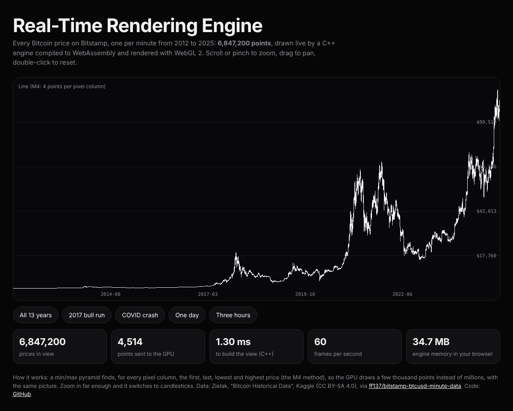
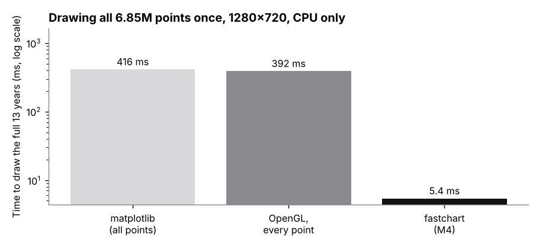
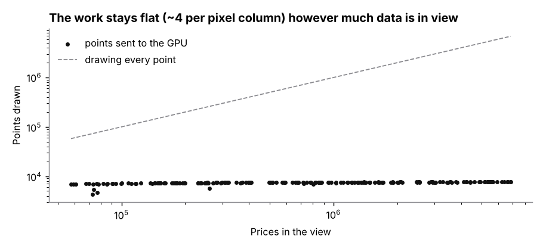
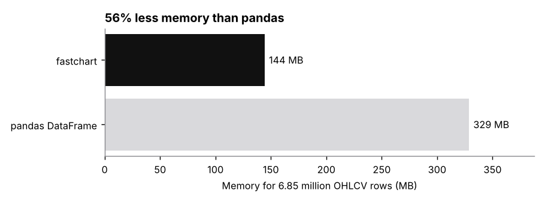
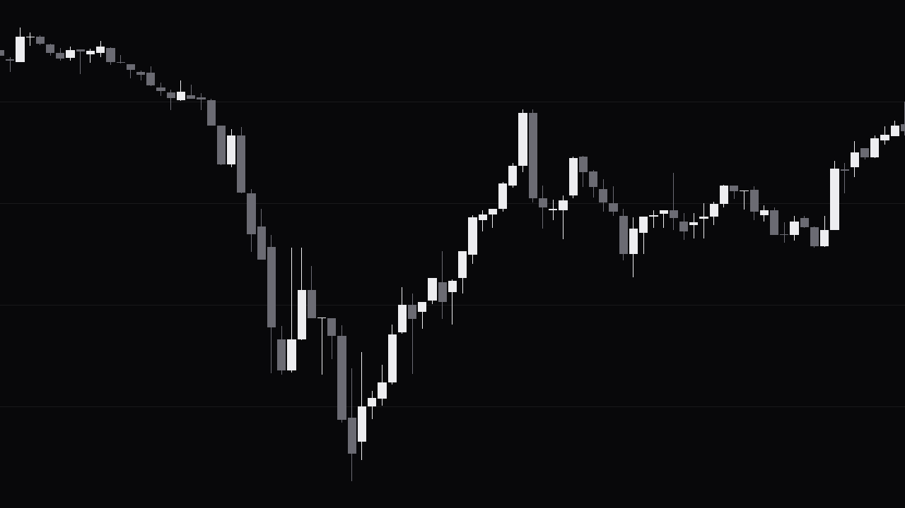

# Real-Time Rendering Engine (fastchart)

**A C++ / OpenGL engine that draws 6.8 million real Bitcoin prices in real time, using 56% less memory than pandas. It runs as a desktop app, as a Python module, and in the browser through WebAssembly.**

[](https://github.com/m-shahmeer-kz/realtime-rendering-engine/actions/workflows/tests.yml)


### [Try the live demo →](https://m-shahmeer-kz.github.io/realtime-rendering-engine/)

[](https://m-shahmeer-kz.github.io/realtime-rendering-engine/)

---

## The problem

Market data is big. Bitstamp's BTC/USD history has one price every minute since 2012: **6,847,200 rows**. Most charting tools either slow to a crawl or quietly drop data. A screen is only about 2,000 pixels wide, so drawing millions of points is mostly wasted work.

## How it works

| Part | What it does |
|---|---|
| **Compact storage (C++)** | Time is not stored, because one row every 60 s means it can be calculated. Prices are stored as 32-bit whole numbers of cents, so they are exact and take half the space of `float64`. |
| **Min/max pyramid** | A small index (5% of the data) answers "lowest and highest price between any two times" in at most a few hundred steps instead of scanning millions of rows. |
| **M4 drawing** | For every pixel column it keeps only the first, last, lowest and highest price ([Jugel et al., VLDB 2014](https://www.vldb.org/pvldb/vol7/p797-jugel.pdf)). This gives the same picture with at most 4 points per column. |
| **OpenGL renderer** | One shader draws lines and candlesticks. Prices are made relative on the CPU in double precision, so the GPU's float32 stays accurate even when zoomed into a few dollars at $100,000. |
| **Candlesticks** | When you zoom in far enough, it switches to OHLC candles built from the raw rows. |
| **Three front ends** | Desktop app (GLFW + OpenGL 3.3), Python module (pybind11, renders headlessly with OSMesa), and browser demo (the same C++ compiled to WebAssembly with WebGL 2). |

## Results

Measured by `python scripts/benchmark.py` (raw numbers in [`reports/benchmarks.json`](reports/benchmarks.json)). The machine was a **2-core cloud VM with no GPU**: OpenGL ran in software (Mesa llvmpipe), so frame times are worst-case. A real graphics card is much faster.

| | Result |
|---|---|
| **Memory** for 6.85M OHLCV rows | **144 MB vs 329 MB in pandas: 56% less** (21 vs 48 bytes per row, pyramid included) |
| **Exactness** of stored prices | Every price is stored exactly to the cent, except 3 of 27.4 million (max error 0.12 cents) |
| **Points sent to the GPU** for the full 13 years | **7,589 instead of 6,847,200** (about 900× fewer) |
| **Time to build a view** (zoom or pan, 1920 px wide, 401 random views) | median **0.05 ms**, slowest **1.1 ms** |
| **Drawing the full history**, 1280×720 | **4.5 ms** vs 392 ms drawing every point (86× faster) |
| Same, compared with **matplotlib** | **5.4 ms** (view + draw) vs 416 ms (77× faster) |
| **Accuracy** vs drawing every point (30 random views) | median 49 pixels differ (0.3% of the line's pixels), at most 138 of 921,600 (0.015% of the image) |
| **Browser download** | 7.8 MB for all 6.85M prices (from 27.4 MB raw), using price changes + varints + gzip |

<p>
  
  
</p>
<p>
  
  
</p>
<sub>Bottom right: 19 May 2021 crash, 3 hours of real OHLC candles, rendered by the engine itself.</sub>

**What I learned**

- **The fastest way to draw a point is not to draw it.** With M4, the work depends on the screen width, not on the data size: about 7,500 points whether the view holds 60 thousand or 6.8 million prices.
- **The data format matters as much as the renderer.** Dropping a timestamp column that can be calculated, and storing cents as integers, saved more memory than any clever trick, and made prices exact.
- **Float32 is a trap for prices.** At $100,000, float32 can't store cents. Keeping prices as integers and subtracting the view's minimum in double precision before sending them to the GPU keeps every pixel accurate.
- **"Same picture" has to be checked.** Comparing rendered pixels against drawing every point showed M4 is not perfectly pixel-exact: about 0.3% of line pixels differ because of how GPUs draw line endpoints. It is visually the same.

## Quick start

```bash
git clone https://github.com/m-shahmeer-kz/realtime-rendering-engine.git
cd realtime-rendering-engine
python scripts/download_data.py           # 6.85M rows of BTC/USD (about 90 MB)

# Python module (Linux: sudo apt install libosmesa6-dev)
pip install ".[dev]"
python scripts/prepare_data.py            # -> data/btcusd.fcbin (+ the web data file)
python scripts/benchmark.py               # -> reports/
pytest -q

# Desktop app (Linux: sudo apt install libglfw3-dev)
cmake -S . -B build && cmake --build build -j
./build/fastchart_app data/btcusd.fcbin   # wheel = zoom, drag = pan, R = reset
ctest --test-dir build                    # C++ tests

# Browser build (needs Emscripten)
emcmake cmake -S . -B build-web && cmake --build build-web
cp build-web/fastchart.* docs/ && cp web/index.html docs/
```

Using it from Python:

```python
import fastchart as fc
df = fc.load_bitstamp("data/btcusd_bitstamp_1min_2012-2025.csv.gz")
series, report = fc.from_dataframe(df)            # pandas -> compact engine format
points = fc.m4(series, series.t0, series.t_end, 1920)   # what to draw for a 1920 px view
image, ms, n = fc.Offscreen(1280, 720).render(series, series.t0, series.t_end)
```

## Project structure

```
include/fastchart/   series.hpp (storage, pyramid, M4, candles) · renderer.hpp
src/                 series.cpp · renderer.cpp (OpenGL / WebGL) · app.cpp (desktop + web) · python.cpp (pybind11 + OSMesa)
python/fastchart/    pandas helpers
web/index.html       browser demo page (axes, stats, touch zoom)
docs/                built demo served by GitHub Pages
scripts/             download_data.py · prepare_data.py · benchmark.py
tests/               C++ tests (CTest) + Python tests (pytest)
```

## Limitations

- Built and tested on Linux. macOS and Windows would need a different OpenGL loader for the desktop app; the browser demo runs everywhere.
- The browser demo ships close prices only (to keep the download small), so its candles are built from minute closes. The desktop app and Python use the full OHLC data.
- Regular time series only (one row every N seconds). Gaps must be filled first, as this dataset already does.

## Data and licence

Code: MIT. Data: Zielak (mczielinski), "Bitcoin Historical Data", Kaggle, **CC BY-SA 4.0**, via [ff137/bitstamp-btcusd-minute-data](https://github.com/ff137/bitstamp-btcusd-minute-data). The compressed close prices in `docs/data/` are an adaptation and are shared under the same licence (see [`docs/data/README.md`](docs/data/README.md)).

## Author

**Muhammad Shahmeer**: Data Science MSc student (University of Naples Federico II), Associate AI Engineer.
[Portfolio](https://m-shahmeer-kz.github.io/) · [LinkedIn](https://www.linkedin.com/in/muhammad-shahmeer-337088338) · [GitHub](https://github.com/m-shahmeer-kz)
